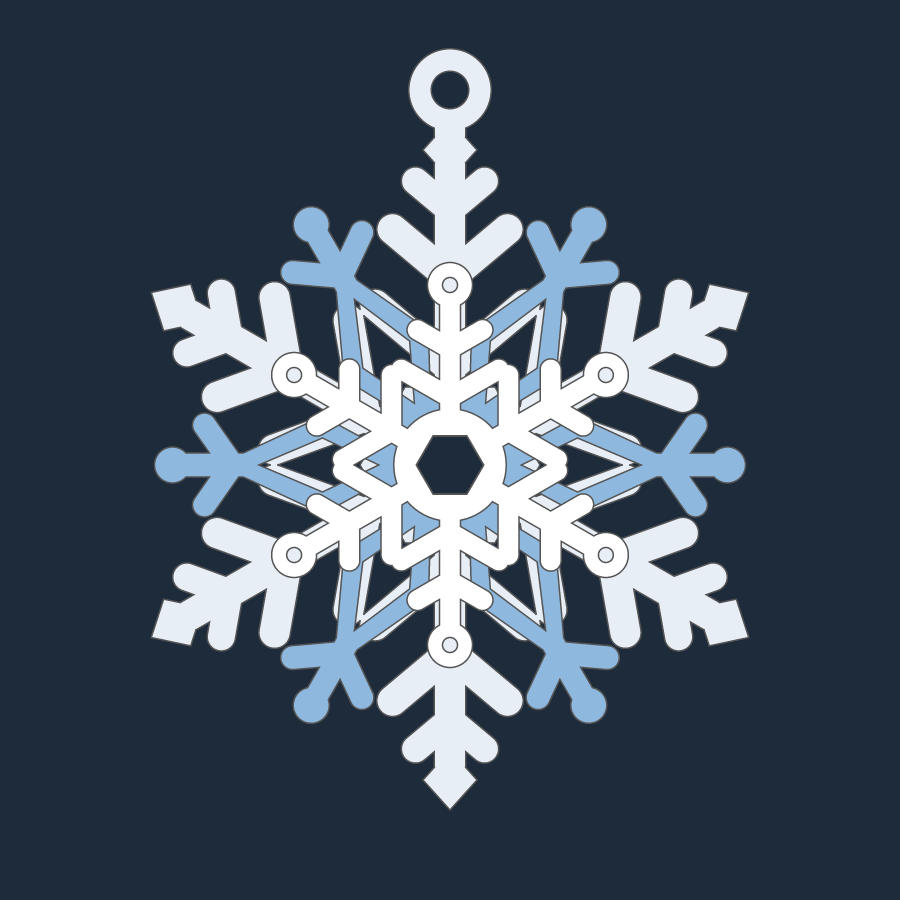
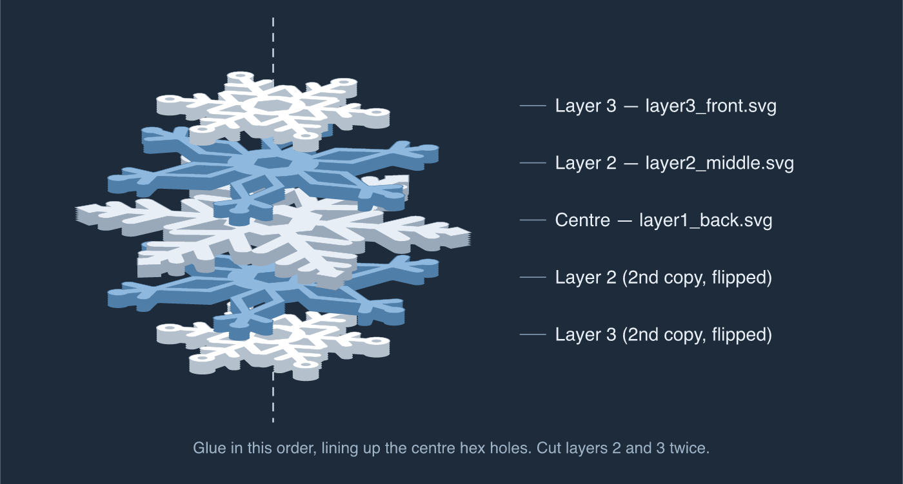
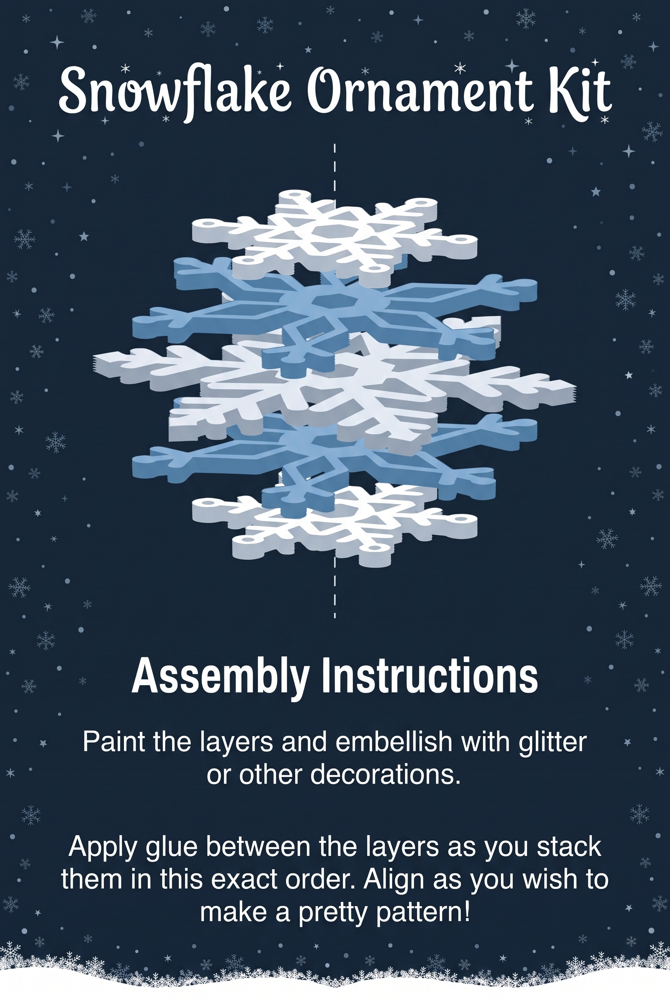

# Snowflake ornament

A 5-layer snowflake ornament for laser cutting, built symmetrically so it looks the
same from both sides. There are only 3 distinct pieces: cut the centre piece once
and layers 2 and 3 twice each.





| File | Size | Cut | Layer |
|---|---|---|---|
| `layer1_back.svg` | 80 × 102 mm | 1 | Centre: thick branching arms, diamond tips, hanging loop (5 mm hole) |
| `layer2_middle.svg` | 79 × 69 mm | 2 | Middle: arms with diamond cutouts, rotated 30° to sit between the centre arms |
| `layer3_front.svg` | 48 × 54 mm | 2 | Outer: thinner star with ringed tips |
| `all_layers_sheet.svg` | | | One of each piece on a sheet (duplicate layers 2 and 3 when laying out) |
| `*_tabs.svg` | | | Same files with holding tabs (see below) |
| `exploded_view.svg` / `.png` | | | Assembly diagram (not for cutting) |
| `Assembly-card.jpeg` | | | Printable assembly instructions card to include with a kit |

Cut lines are red, 0.1 mm wide, in millimetres. Import at 1:1.

## Cutting and assembly

- Designed for 3 mm plywood or acrylic (1.5–2 mm also works). No part is narrower than about 2 mm.
- The files don't allow for kerf.
- Stack order is 3, 2, centre, 2, 3 (see the exploded view). Every piece is mirror-symmetric, so the second copies don't need flipping when you cut them.
- All pieces have the same hexagonal hole in the centre. Line those up (a pencil or dowel through the hole helps) and glue outward from the centre piece on each side.

## Assembly card

`Assembly-card.jpeg` is a printable instruction card for the kit: paint and decorate
the layers, then glue them in the order shown.



## Holding tabs

The `*_tabs.svg` files leave two small uncut gaps in each piece's outer outline,
in the valleys between arms and directly opposite each other, so the pieces stay
in the sheet until you snap them out. Tabs are 0.5 mm wide by default; the laser's
kerf makes the material bridge a little narrower than that.

```bash
python make_snowflake.py --tabs                  # 0.5 mm tabs
python make_snowflake.py --tabs --tab-width 0.8  # wider tabs
```

## Changing the design

Edit `make_snowflake.py` and run it to regenerate the SVGs, preview and exploded view:

```bash
pip install shapely resvg-py   # resvg-py is optional, renders the PNG images
python make_snowflake.py
```
